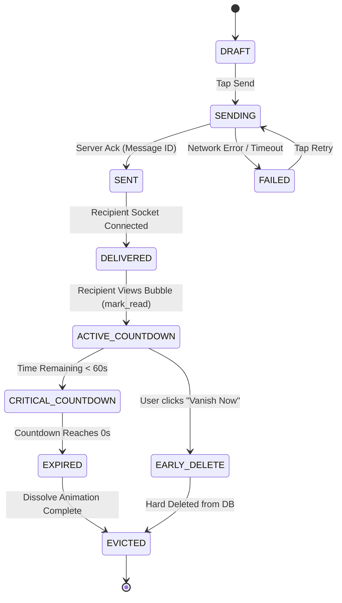
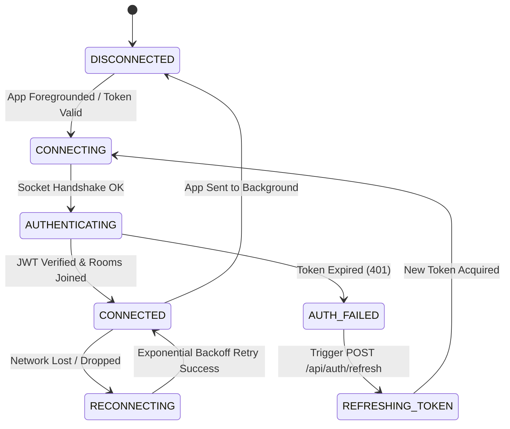

# Floww — App Flow & Navigation State Machines

> **Document Version:** 1.0.0  
> **Target Framework:** Jetpack Navigation Compose + Sealed Class Routes  
> **Pattern:** Signal-Android Navigation & Elm-like State Machines  

---

## 1. Screen Hierarchy & Navigation Graph

```text
                               ┌───────────────────┐
                               │    Splash Screen  │
                               └─────────┬─────────┘
                                         │
                        Is JWT Token present & valid?
                                         │
                     ┌───────────────────┴───────────────────┐
                    NO                                      YES
                     ▼                                       ▼
         ┌───────────────────────┐               ┌───────────────────────┐
         │     Auth Flow Root    │               │    Main App Shell     │
         │  (Welcome / Onboard)  │               │  (Floating Tab Bar)   │
         └───────────┬───────────┘               └───────────┬───────────┘
                     │                                       │
        ┌────────────┴────────────┐            ┌─────────────┼─────────────┐
        ▼                         ▼            ▼             ▼             ▼
┌───────────────┐         ┌─────────────┐ ┌─────────┐   ┌─────────┐   ┌──────────┐
│ Login Screen  │         │ Register    │ │  Chats  │   │ Friends │   │ Settings │
└───────────────┘         └─────────────┘ └───┬─────┘   └────┬────┘   └──────────┘
                                              │              │
                                              ▼              ▼
                                     ┌─────────────────┐ ┌────────────────┐
                                     │   Chat Room     │ │ Add Friend /   │
                                     │ (1-on-1 / Group)│ │ QR Scanner     │
                                     └────────┬────────┘ └────────────────┘
                                              │
                                     ┌────────┴────────┐
                                     │  Room Settings  │
                                     │  & Timer Picker │
                                     └─────────────────┘
```

---

## 2. Navigation Routes & Arguments

In Compose, routes are modeled as a type-safe sealed class hierarchy:

```kotlin
sealed interface ScreenRoute {
    // Auth Routes
    data object Welcome : ScreenRoute
    data object Login : ScreenRoute
    data object Register : ScreenRoute

    // Main Tabs (Nested under MainShell)
    data object ChatList : ScreenRoute
    data object FriendsList : ScreenRoute
    data object Settings : ScreenRoute

    // Detail & Action Routes
    data class ChatRoom(val roomId: String) : ScreenRoute
    data class RoomDetails(val roomId: String) : ScreenRoute
    data object CreateGroup : ScreenRoute
    data object AddFriend : ScreenRoute
    data object UserProfile : ScreenRoute
    data object QrInviteCode : ScreenRoute
}
```

---

## 3. End-to-End User Journeys

### Journey 1: First-Time User Registration & Onboarding
1. **Welcome Screen:** User launches app for the first time. Sees animated liquid glass logo with tagline: *"Disappearing conversations. Zero traces."*
2. **Options:** Tap `Create Account` or `I already have an account`.
3. **Register Screen:**
   * Enter `@username` (live debounce checks uniqueness against `/api/users/search`).
   * Enter `Display Name` and `Password` (min 8 chars, 1 number, 1 special char).
   * Submit $\to$ API returns `{ accessToken, refreshToken, user }`.
4. **Token Persistence:** Stored encrypted via `EncryptedSharedPreferences`.
5. **Auto-Transition:** Screen animates with an Apple-style morph into `ChatList`.

### Journey 2: Adding a Friend & Initiating a 1-on-1 Chat
1. User navigates to **Friends** tab.
2. Taps floating glass `+` button $\to$ navigates to `AddFriendScreen`.
3. Enters friend's username (e.g. `@aryan`) or scans friend's QR invite code.
4. Friend receives real-time notification (`FRIEND_REQUEST`).
5. Friend taps `Accept` $\to$ Backend establishes two-way friendship and generates deterministic `dmKey`.
6. User taps friend's profile $\to$ taps `Start Chat` $\to$ navigates directly to `ChatRoomScreen(roomId)`.

### Journey 3: The Disappearing Chat Life Cycle (Message to Vapor)
1. **Composer Focus:** Sender taps text box in `ChatRoomScreen`.
2. **Typing Event:** As sender types, `ws:typing` event is emitted. Recipient sees subtle glowing animated dots: *"Alice is typing..."*.
3. **Send Message:** Sender hits Send.
   * Optimistic UI: Bubble renders instantly with a faint gray clock icon (Status: `SENDING`).
   * WebSocket confirms receipt: Clock changes to single tick `✓` (Status: `SENT`).
4. **Delivery & View:**
   * Recipient receives message via `ws:new_message`. Double tick `✓✓` appears for sender.
   * As soon as message scrolls into recipient's visible viewport, recipient client fires `ws:mark_read`.
5. **Timer Activation (Read-Triggered):**
   * If room timer is active (30s, 5m, 1h, 24h):
     * Backend sets `firstReadAt = now()` and calculates `expiresAt = firstReadAt + duration`.
     * Both sender and recipient bubbles show the ultra-compact 10dp hairline circular draining ring (`20:25 ◷ ✓✓`).
   * If room timer is `Off (Permanent)`:
     * Message remains permanently (`expiresAt = null`), showing clean time and double ticks (`20:25 ✓✓`).
6. **Vanish Moment (For Expiring Messages):**
   * When `expiresAt` is reached, backend cron deletes row from PostgreSQL.
   * WebSocket sends `ws:message_expired`.
   * The bubble dissolves smoothly via soft blur and alpha fade over $320\text{ms}$.

---

## 4. Critical State Machines

### 4.1 Message State Machine



### 4.2 WebSocket Connection Lifecycle


